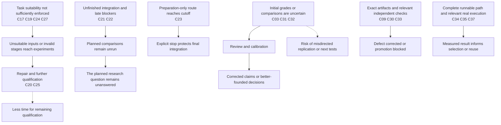

# Matura hackathon retrospective evidence record

Assembled 8 October 2026. Events primarily occurred 25–27 September 2026. Times use Europe/Warsaw; recorded September timestamps are UTC+02:00.

This record covers **38 investigated cases and two context records** from the retrospective discussion. It is a reusable evidence base for a team report, not a census of every repository action or a final improvement plan. The 38 cases are a descriptive inventory, not 38 independent observations. Typed relationships distinguish repairs, dependencies, reused evidence and thematic comparisons.

The user reports **46/60 on the final competition exam**, versus the winner's **54/60**, and substantial strategic intervention despite the intended autonomy. The preserved **40/60 validation result used a different exam**. No causal gain from final RAG or any single change follows from that comparison.

## Using the record

Start with the [team-facing post-mortem](TEAM_POSTMORTEM.md) for the agreed diagnosis and operating changes. This evidence register remains the detailed reference.

- [Detailed case cards](CASE_DETAILS.md): expectation, sequence, outcome, effects, decision, initiative, interpretation, limits and sources.
- [Case table](retrospective_cases.csv): one row per case/context, with separate quality, operational and learning effects.
- [Time ledger](retrospective_time_ledger.csv): run durations and non-additive elapsed windows.
- [Structured evidence](evidence_record.json): full reusable snapshot.
- [Editable causal diagram](causal_map.mmd).

CSVs use UTF-8 and semicolon-separated IDs in relationship fields. Blank durations mean unavailable, never zero. The JSON is the complete structured snapshot; the tables and narrative views derive from it. No numerical success rating is assigned.

## Evidence and interpretation

**Observed** means supported by the cited artifact or contemporaneous record. **Interpretation** is an explanation, qualified in each case. **User-reported** identifies recollection or outcome without an inspected organizer result. **Unresolved** preserves missing information rather than treating silence as proof.

Account identity does not establish human versus agent authorship. Direct user interventions are identified where recovered. Repository instructions were historical evidence only. Repository file citations formerly on main are pinned to revision **b4f2d9abdc546788d09b64d352cda35ed8e5f2cf**; issue comments and chat links remain access-dependent and potentially mutable.

## Case index

| ID | Episode | Group and classification | Verified outcome |
|---|---|---|---|
| [C01](CASE_DETAILS.md#c01) | Lead mandate and autonomous research expectations | Strategy / governance | Ownership and pivot instructions existed; lack of instructions alone does not explain the outcome. |
| [C02](CASE_DETAILS.md#c02) | Initial full-exam baseline and working-model choice | Evaluation / selection and measurement | A defensible provisional baseline choice was made; it did not establish permanent model superiority. |
| [C03](CASE_DETAILS.md#c03) | Question-policy candidate and adjudication | Evaluation / valid negative and confounded comparison | The combined candidate failed to beat the baseline point estimate; policy-specific causality was not isolated. |
| [C04](CASE_DETAILS.md#c04) | Qwen budget limitations and later challenger | Model and runtime / configuration and model selection | The early completion limitation is documented. The later 40/60 package was not a budget-only experiment. |
| [C05](CASE_DETAILS.md#c05) | Spark smoke success and speedup claim corrected | Runtime evidence / false readiness and correction | The successful-answer speedup claim was invalid. The original failing Spark/Qwen path was not shown repaired and rerun. |
| [C06](CASE_DETAILS.md#c06) | Supplementary audit verifier false passes and provenance claims | Runtime evidence / verification defect and repair | The verifier was repaired; the valid finding of 16 empty Spark responses remained unchanged. |
| [C07](CASE_DETAILS.md#c07) | Gemma Spark load failure and RTX transfer | Model and runtime / capacity failure and alternative execution | The task became operational on another hardware path; Spark itself was not demonstrated repaired. |
| [C08](CASE_DETAILS.md#c08) | Working RTX run but broken published reproduction | Integration / reproducibility defect and repair | Public reproducibility and guard claims were corrected without rerunning the historical transfer. |
| [C09](CASE_DETAILS.md#c09) | Strict data eligibility and internal holdout export repair | Data / construction defect and successful review | Unsafe export behavior was corrected before the flawed version merged; the 200-record target remained unmet. |
| [C10](CASE_DETAILS.md#c10) | Canonical-source aliases defeated the first split repair | Data / residual leakage and correction | A second, different split defect was corrected; the tiny holdout was unsuitable for strong model-selection claims. |
| [C11](CASE_DETAILS.md#c11) | Essay corpus collision checks and independent factual repairs | Data / adaptive scoping and successful verification | A checked corpus handoff was produced without automatically authorizing training or claiming model gains. |
| [C12](CASE_DETAILS.md#c12) | 107-source RAG result and overextended strategic inference | Retrieval / scope mismatch and confounded negative | The tested configuration failed; this did not establish that full-Wikipedia retrieval was unhelpful. |
| [C13](CASE_DETAILS.md#c13) | Retrieval variants stopped and resources reassigned | Retrieval / valid narrow negatives and strategic pivot | A real mechanism change followed negative evidence, but all retrieval variants retained the narrow corpus. |
| [C14](CASE_DETAILS.md#c14) | Global expert audit informed a revised portfolio | Strategy / expert synthesis and uncertain continuity | Expert synthesis existed and affected scheduling; persistent automatic re-synthesis after later results was not established. |
| [C15](CASE_DETAILS.md#c15) | Low reasoning cap recognized as an invalid capability test | Model and runtime / failure diagnosis and revised experiment | A configuration failure was not accepted as proof that thinking was ineffective. |
| [C16](CASE_DETAILS.md#c16) | Visual assistance failed replication and was parked | Vision / replication and valid stop | A promising small result did not earn promotion when replication failed. |
| [C17](CASE_DETAILS.md#c17) | Whole-page visual inputs inspected with incomplete acceptance criteria | Vision / input validity and review judgment | Visual inspection occurred, but its acceptance criterion did not require removing irrelevant neighboring material. |
| [C18](CASE_DETAILS.md#c18) | Early source-group crop prototype had disputed gain | Vision / limited prototype and uncertain measurement | Genuine layout-aware cropping existed before the later correction, without a secure gain or general pipeline. |
| [C19](CASE_DETAILS.md#c19) | Generic quadrant zoom was not source-image extraction | Vision / valid narrow negative and review scope gap | The tiling method did not help this panel; it did not test removal of irrelevant page content. |
| [C20](CASE_DETAILS.md#c20) | User-requested source crops and organizer package integration | Integration / input correction and successful compatibility test | Corrected inputs and package compatibility were demonstrated. Later Gemma scores were 39/60 versus 38/60 previously. |
| [C21](CASE_DETAILS.md#c21) | Six-topic argument-planning study remained prepared but unused | Execution / handoff and unfinished integration | The intended selection question was not answered by a model run. |
| [C22](CASE_DETAILS.md#c22) | Structured-route diagnostic missed both launch windows | Execution / dependency and blocker visibility failure | Zero scored calls and zero warmups; the lead ultimately stopped and reassigned resources. |
| [C23](CASE_DETAILS.md#c23) | Essay RAG preparation explicitly stopped at its deadline | Retrieval / dependency delay and deliberate stop | This was a documented deadline stop, not a negative experiment or purely unexplained abandonment. |
| [C24](CASE_DETAILS.md#c24) | Full-Wikipedia filter first run failed its auxiliary contract | Auxiliary mechanisms / invalid mechanism and late detection | 53 attempts and 28m48s yielded bare-fallback answers rather than a functioning RAG quality comparison. |
| [C25](CASE_DETAILS.md#c25) | Repaired filter became measurable but remained expensive | Auxiliary mechanisms / successful repair and limited diagnostic | The functioning diagnostic scored 3/6 to 4/6, with two gains and one regression; it was not a full-exam promotion. |
| [C26](CASE_DETAILS.md#c26) | Fast Qwen full-Wikipedia diagnostic tied the direct route | Retrieval / limited neutral diagnostic | No demonstrated retrieval-backed gain on this panel; speed improvement was not a controlled cross-model comparison. |
| [C27](CASE_DETAILS.md#c27) | Factual referee returned rewrites instead of valid selections | Auxiliary mechanisms / failed selection and mixed useful evidence | The 33m46s batch yielded useful A/B evidence, 7/12 versus 5/12, but zero functioning referee selections. |
| [C28](CASE_DETAILS.md#c28) | Essay branching found a better draft but rewriting lost it | Essays / generation success and selection degradation | The branch generated useful material, but the combined selector/rewrite degraded the exported result. |
| [C29](CASE_DETAILS.md#c29) | Correct essay choice rejected by strict fence parsing | Essays / serialization defect and replay repair | The repair recovered an existing good choice; it was not a new model run or regraded 11-point result. |
| [C30](CASE_DETAILS.md#c30) | LoRA qualification rejected a failing deployed candidate | Training / useful negative and resource reallocation | The candidate failed operationally and on available content comparisons; it was not deployed. |
| [C31](CASE_DETAILS.md#c31) | Essay critic gain shrank after independent calibration | Grading / calibration disagreement and corrected claim | Apparent benefit shrank from +13 to +4 across FOUR essays, not a full 40-item exam. |
| [C32](CASE_DETAILS.md#c32) | Conservative essay span edits gave no added benefit | Essays / valid narrow negative and measurement checks | No measured patch benefit; the count of patched outputs overstated how many texts actually changed. |
| [C33](CASE_DETAILS.md#c33) | Three-rater aggregation bug caught before use | Grading / evaluator defect and successful prevention | A consequential evaluator bug was corrected without invalidating unrelated existing grades. |
| [C34](CASE_DETAILS.md#c34) | Recovery rehearsal qualified complete-answer delivery | Delivery / operational success with limited quality benefit | Recovery worked operationally; the score remained 38/60 and recovered answers were not automatically correct. |
| [C35](CASE_DETAILS.md#c35) | Full Qwen confirmation replaced an optimistic composite | Selection / measured confirmation and successful handoff | A real full-system result replaced posthoc composition and informed selection. |
| [C36](CASE_DETAILS.md#c36) | Reopened parallel essay RAG exceeded actual serving concurrency | Retrieval / capacity assumption and mixed result | One limited positive essay signal and a useful concurrency finding, not a completed three-way comparison. |
| [C37](CASE_DETAILS.md#c37) | Frozen manual workflow passed a real limited delivery smoke | Delivery / integration and resumability success | The reviewed manual integration and resume path worked on a limited DEV package. |
| [C38](CASE_DETAILS.md#c38) | Aggregate weight constraint changed architecture scope | Governance / external constraint and replanning | A material external constraint was incorporated into the strategy. |
| [C39](CASE_DETAILS.md#c39) | Final competition result and limits of attribution | Outcome context / user-reported outcome | Useful delivery was achieved, but the reported competitive and autonomy expectations were not met. |
| [C40](CASE_DETAILS.md#c40) | Activity counts and incomplete project time accounting | Outcome context / measurement limit | Local elapsed costs and summed run durations are quantifiable; the share of the project spent on bureaucracy is not. |

## Typed case relationships

These relationships prevent related phases from being counted as independent experiments. Unlisted related IDs are thematic references, not independence claims.

| From | Relationship | To | Boundary |
|---|---|---|---|
| [C05](CASE_DETAILS.md#c05) | verifier_followup | [C06](CASE_DETAILS.md#c06) | Related assurance defect; same underlying Spark raw evidence, no new inference. |
| [C07](CASE_DETAILS.md#c07) | delivery_repair | [C08](CASE_DETAILS.md#c08) | Repair to the published runner after a private runtime transfer. |
| [C09](CASE_DETAILS.md#c09) | residual_defect_followup | [C10](CASE_DETAILS.md#c10) | A source-identity issue in the same data/split chain. |
| [C09](CASE_DETAILS.md#c09) | distinct_dataset_comparison | [C11](CASE_DETAILS.md#c11) | Later essay corpus excluded the earlier records; not a merged sample. |
| [C12](CASE_DETAILS.md#c12) | same_corpus_followup | [C13](CASE_DETAILS.md#c13) | Different mechanisms on the same limited corpus. |
| [C14](CASE_DETAILS.md#c14) | strategy_context | [C13](CASE_DETAILS.md#c13) | Expert diagnosis informed the broader portfolio; no extra experiment count. |
| [C17](CASE_DETAILS.md#c17) | input_alternative | [C18](CASE_DETAILS.md#c18) | Small layout-aware prototype, distinct from quadrants. |
| [C17](CASE_DETAILS.md#c17) | input_alternative | [C19](CASE_DETAILS.md#c19) | Generic zoom retained the original full page. |
| [C17](CASE_DETAILS.md#c17) | input_correction | [C20](CASE_DETAILS.md#c20) | Later source-specific image and package correction. |
| [C21](CASE_DETAILS.md#c21) | separate_prepared_study | [C22](CASE_DETAILS.md#c22) | Related planning work but different cases/denominators and no-call evidence. |
| [C23](CASE_DETAILS.md#c23) | owner_reopened_route | [C36](CASE_DETAILS.md#c36) | Later diagnostic after an explicit prep cutoff; not the original promised run. |
| [C24](CASE_DETAILS.md#c24) | repair_followup | [C25](CASE_DETAILS.md#c25) | V2 is a repair of the failed filter, not independent replication of full RAG strategy. |
| [C25](CASE_DETAILS.md#c25) | different_model_followup | [C26](CASE_DETAILS.md#c26) | Different model/profile and panel result; not a clean speed or quality attribution. |
| [C27](CASE_DETAILS.md#c27) | different_selector_comparison | [C29](CASE_DETAILS.md#c29) | Factual referee versus essay saved-ID selector; do not merge outcomes. |
| [C28](CASE_DETAILS.md#c28) | same_response_replay_repair | [C29](CASE_DETAILS.md#c29) | Replays one saved selection response; no new inference or regrading. |
| [C31](CASE_DETAILS.md#c31) | research_followup | [C32](CASE_DETAILS.md#c32) | Conservative edit direction after critic uncertainty; different samples. |
| [C32](CASE_DETAILS.md#c32) | proposed_mechanism_followup | [C21](CASE_DETAILS.md#c21) | No-gain span editing preceded a plan-to-prose proposal. |
| [C11](CASE_DETAILS.md#c11) | data_to_candidate_evaluation | [C30](CASE_DETAILS.md#c30) | Data preparation and later evaluation have separate costs and outcomes. |
| [C34](CASE_DETAILS.md#c34) | qualified_runtime_reuse | [C35](CASE_DETAILS.md#c35) | Recovery qualification reused in the full confirmation. |
| [C20](CASE_DETAILS.md#c20) | integration_dependency | [C37](CASE_DETAILS.md#c37) | Input/package integration contributed to final delivery. |
| [C35](CASE_DETAILS.md#c35) | preserved_candidate_dependency | [C37](CASE_DETAILS.md#c37) | Measured direct answers preserved before owner-selected RAG. |
| [C36](CASE_DETAILS.md#c36) | runtime_lesson_to_delivery | [C37](CASE_DETAILS.md#c37) | Single-slot observation informed serial final calls. |
| [C35](CASE_DETAILS.md#c35) | different_exam_context | [C39](CASE_DETAILS.md#c39) | Known-validation and user-reported final scores are not a causal paired comparison. |

## Refined causal map

The strongest cross-case synthesis is **overestimating readiness at a handoff**: an input, mechanism, result or assignment was sometimes treated as more usable than demonstrated. This is a synthesis, not a proven single root cause.

Solid arrows describe documented local sequences. Dashed arrows express inferred project-level consequences. The diagram highlights main paths; the edge table also records narrower relationships and hypotheses. Documented sequences do not exclude every alternative cause. No edge quantifies exam points lost.

| Edge | Relationship | Evidence strength | Cases | Boundary |
|---|---|---|---|---|
| M01 | Task suitability insufficiently checked or enforced → Unsuitable inputs or invalid stage outputs reach experiments | documented sequence | [C17](CASE_DETAILS.md#c17), [C19](CASE_DETAILS.md#c19), [C24](CASE_DETAILS.md#c24), [C27](CASE_DETAILS.md#c27) | Image audit waived extra content; stage runtime accepted the wrong response unit. |
| M02 | Unsuitable inputs or invalid stage outputs reach experiments → Repair and further qualification | documented sequence | [C20](CASE_DETAILS.md#c20), [C24](CASE_DETAILS.md#c24), [C25](CASE_DETAILS.md#c25), [C27](CASE_DETAILS.md#c27) | Repairs were needed; the referee route was not successfully requalified. |
| M03 | Repair and further qualification → Less decision-ready evidence before deadlines | inferred aggregate consequence | [C23](CASE_DETAILS.md#c23), [C24](CASE_DETAILS.md#c24), [C25](CASE_DETAILS.md#c25) | Specific elapsed windows are known; displaced alternative results are not. |
| M04 | Unfinished dependencies and late blocker information → Launch windows expire without execution | documented sequence | [C21](CASE_DETAILS.md#c21), [C22](CASE_DETAILS.md#c22) | Known missing integration and retrospectively reported usage limits; no experiment calls. |
| M05 | Promised experiments miss launch windows → Planned evidence unavailable at its decision cutoff | documented local consequence | [C21](CASE_DETAILS.md#c21), [C22](CASE_DETAILS.md#c22) | Does not imply continuous idle time or an available replacement worker. |
| M06 | Uncertain or inconsistent initial grades → Review and recalibration | documented sequence | [C03](CASE_DETAILS.md#c03), [C31](CASE_DETAILS.md#c31), [C32](CASE_DETAILS.md#c32) | Includes subjective interpretation and scoped arithmetic corrections. |
| M07 | Initial uncertain estimates → Potentially misdirected replication or next tests | inferred risk with local trace | [C31](CASE_DETAILS.md#c31) | Raw grades guided replication; net harm and opportunity cost remain unmeasured. |
| M08 | Exact artifacts and an independent relevant check → Defect corrected or promotion blocked | documented sequence | [C09](CASE_DETAILS.md#c09), [C10](CASE_DETAILS.md#c10), [C30](CASE_DETAILS.md#c30), [C33](CASE_DETAILS.md#c33) | Reviews had concrete consequences; each repair retained its limits. |
| M09 | Complete inputs and compatible runnable path → Bounded real execution | documented sequence; causal contribution inferred | [C34](CASE_DETAILS.md#c34), [C35](CASE_DETAILS.md#c35), [C37](CASE_DETAILS.md#c37) | Actual launches followed closed prerequisites; success cases were also less novel. |
| M10 | Bounded real execution → Measured result informs selection or reuse | documented sequence | [C34](CASE_DETAILS.md#c34), [C35](CASE_DETAILS.md#c35), [C37](CASE_DETAILS.md#c37) | Completion, quality and limited smoke qualification were kept distinct. |
| M11 | Independent review or failed-result gate → Harmful promotion is interrupted | documented containment | [C03](CASE_DETAILS.md#c03), [C09](CASE_DETAILS.md#c09), [C30](CASE_DETAILS.md#c30), [C31](CASE_DETAILS.md#c31) | Containment does not quantify all avoided damage and can still cost time. |
| M12 | High-level mandate without continuously enforced synthesis → Insufficient strategic follow-through | hypothesis | [C01](CASE_DETAILS.md#c01), [C14](CASE_DETAILS.md#c14) | Explicit instructions existed and meaningful pivots occurred; no single-cause proof. |
| M13 | Review and recalibration → Corrected claims or more defensible decisions | documented corrective sequence | [C03](CASE_DETAILS.md#c03), [C31](CASE_DETAILS.md#c31), [C32](CASE_DETAILS.md#c32) | Calibration improved reliability; it is not automatically a loss of usable evidence. |
| M14 | Preparation-only route reaches its cutoff → Explicit stop protects final integration | documented decision | [C23](CASE_DETAILS.md#c23) | No promised GPU launch was canceled; whether continuation would have paid off is unknown. |
| M15 | Input or configuration changes are combined → Mechanism-specific conclusions remain uncertain | documented comparison limitation | [C03](CASE_DETAILS.md#c03), [C04](CASE_DETAILS.md#c04), [C20](CASE_DETAILS.md#c20), [C26](CASE_DETAILS.md#c26) | A useful candidate screen may still be a weak causal experiment. |

## Mixed effects view

A single positive/negative label loses information. The CSV and case cards retain all three effects for every case.

| Case | Quality | Operations | Learning |
|---|---|---|---|
| [C05](CASE_DETAILS.md#c05) | No exam-quality evidence was produced. | Reporting was corrected about 19 minutes after merge; further audit work was required. | Raw artifacts supported correction and prevented continued reliance on the headline. |
| [C09](CASE_DETAILS.md#c09) | No contaminated training run or final-score damage was established. | Repair produced a smaller truthful handoff and fail-closed export. | Independent inspection of actual output overrode stale eligibility labels. |
| [C19](CASE_DETAILS.md#c19) | No gain in the tested zoom panel. | The intended algorithm ran successfully. | Pixel preservation did not prove the tiles formed useful visual units. |
| [C25](CASE_DETAILS.md#c25) | Small exploratory gain with relevance errors remaining. | Repair-to-declaration and grading consumed additional elapsed time; the report arrived near the diagnostic cutoff. | A real probe directly addressed the original qualification gap. |
| [C27](CASE_DETAILS.md#c27) | Export preserved 7/12; retrospective oracle was 8/12. | 31 calls include candidate generation, so selector-only cost is unavailable. | A working referee's value remained untested. |
| [C30](CASE_DETAILS.md#c30) | No quality win; incomplete attempts remained in denominators. | Training/preparation cost exceeds this evaluation duration and is not fully measured. | Negative evidence changed the next action and protected remaining resources. |
| [C31](CASE_DETAILS.md#c31) | Magnitude and consistency were less secure; no deployment on the raw gain was traced. | About 51 minutes elapsed from announcement to lead correction, not measured active reviewer time. | Raw grades had guided replication; independent review changed subsequent claims/protocol. |
| [C34](CASE_DETAILS.md#c34) | Previously blank items recovered only 1/6 points; other changes offset quality gains. | The tested recovery harness was reused. | Failure behavior was exercised end-to-end rather than inferred from mocked success. |
| [C35](CASE_DETAILS.md#c35) | 40/60 measured on known validation; not proof of robust superiority over Gemma 39 or final-exam uplift. | A complete executable path yielded fast dispatch and terminal evidence. | The standalone essay gain did not repeat fully, and that was retained rather than hidden. |
| [C37](CASE_DETAILS.md#c37) | No full-exam quality gain was measured by the smoke. | A runnable delivery entry point and recovery behavior were demonstrated. | The actual PowerShell-to-remote-to-export path was exercised. |

## Time accounting

The original nine sampled batches sum to **3h 21m 33s** of recorded run durations. This selected sample is not GPU utilization, active agent work, human effort or elapsed project delay. Supplemental runs are separate so the earlier subtotal remains reproducible. Failed or negative outcomes are not automatically wasted time.

| Interval | Case | Duration | Meaning and aggregation boundary |
|---|---|---|---|
| T01 | [C13](CASE_DETAILS.md#c13) | 0h 5m 19s | Retrieval variants wave; run_duration; core_9. Two readiness calls lie outside this timed wave. |
| T02 | [C34](CASE_DETAILS.md#c34) | 0h 19m 17s | Recovery rehearsal; run_duration; core_9. Includes recovery and injected faults. |
| T03 | [C19](CASE_DETAILS.md#c19) | 0h 6m 11s | Generic visual zoom; run_duration; core_9. Eight slots; no gain does not make the duration automatically wasted. |
| T04 | [C30](CASE_DETAILS.md#c30) | 0h 45m 50s | LoRA evaluation; run_duration; core_9. Evaluation only; training/export/setup excluded. Control/candidate subtimes are included, not additional. |
| T05 | [C24](CASE_DETAILS.md#c24) | 0h 28m 48s | Fullwiki filter v1; run_duration; core_9. Whole batch includes direct/fallback answers; intended filtering failed. |
| T06 | [C27](CASE_DETAILS.md#c27) | 0h 33m 46s | A/B and referee; run_duration; core_9. Includes 20 A/B finals and ten failed selectors; selector-only time unknown. |
| T07 | [C25](CASE_DETAILS.md#c25) | 0h 31m 51s | Fullwiki filter v2; run_duration; core_9. Includes four probes, retries and final answers. |
| T08 | [C35](CASE_DETAILS.md#c35) | 0h 27m 58s | Qwen full40 confirmation; run_duration; core_9. 44 calls include four recovered timeouts. |
| T09 | [C36](CASE_DETAILS.md#c36) | 0h 2m 33s | Parallel essay RAG; run_duration; core_9. Three client trials share one operator interval; do not multiply by three. |
| T10 | [C32](CASE_DETAILS.md#c32) | 0h 18m 10s | Exact-span essay edit; run_duration; supplemental. Newly added to this record; excluded from the previously reported nine-batch subtotal. |
| T11 | [C37](CASE_DETAILS.md#c37) | 0h 5m 34s | Final two-item delivery smoke; run_duration; supplemental. Limited DEV smoke, not full-exam runtime; resume issued zero new model calls. |
| T12 | [C07](CASE_DETAILS.md#c07) | 0h 2m 27s | RTX runtime transfer; run_duration; supplemental. 40 nonempty answers, not a fresh quality qualification of later wrapper repairs. |
| T13 | [C26](CASE_DETAILS.md#c26) | 0h 15m 7s | Fast Qwen retrieval diagnostic; run_duration; supplemental. Excluded from the historical core-nine subtotal; shorter auxiliary calls do not constitute an isolated cross-model speed comparison. |
| E01 | [C05](CASE_DETAILS.md#c05) | 0h 19m 7s | Spark report correction latency; correction_latency; not_additive. Elapsed correction window, not active repair effort. |
| E02 | [C09](CASE_DETAILS.md#c09) | 0h 20m 37s | Strict export repair and approval; repair_review_elapsed; not_additive. Coding, review and waiting not separable. |
| E03 | [C24](CASE_DETAILS.md#c24) | 0h 34m 29s | Filter failure to repaired declaration; repair_review_elapsed; not_additive. Not pure debugging time; overlaps other work. Also linked to C25. |
| E04 | [C31](CASE_DETAILS.md#c31) | 0h 51m 14s | Essay gain announcement to calibrated lead response; claim_correction_elapsed; not_additive. Not active reviewer time; exact issue-comment stamps are not consistently exposed by the connector. |
| E05 | [C22](CASE_DETAILS.md#c22) | 0h 45m 49s | Structured study missed start to expiry; no_launch_window; not_additive. Zero experiment calls. Idle snapshots do not prove continuous idleness or available replacement workers. |
| E06 | [C23](CASE_DETAILS.md#c23) | 2h 14m 24s | Index-ready report to essay-prep stop; preparation_elapsed; not_additive. No GPU calls for this prep-only case; not active labor. |
| E07 | [C35](CASE_DETAILS.md#c35) | 0h 1m 38s | Qwen declaration to launch; dispatch_latency; not_additive. Pre-declaration preparation excluded. |
| E08 | [C20](CASE_DETAILS.md#c20) | 0h 14m 28s | Organizer mock task to integrated PR; issue_to_merge_elapsed; not_additive. Not total implementation effort; preparatory work may precede issue creation. |

Filter v1/referee overlapped by about 23 minutes; filter v2/Qwen confirmation by about 24 minutes. Host records do not justify assuming same-GPU contention. Retries, probes and candidate-stage durations are inside parent totals. Three parallel essay clients share one operator interval. Repair windows and issue lifetimes must not be added to run durations as time lost.

No complete activity ledger supports a defensible percentage spent on coordination, repair or waiting. The prior snapshot's 145 PRs, 47 issues, 583 discussion comments and nine review records are activity counts. Idle snapshots are not proof of continuous idleness.

## Selected timestamped view

This is not a complete timeline. Gaps are unobserved, not assumed idle. Intervals do not imply continuous labor.

| Start Warsaw | End Warsaw | Case | Interval |
|---|---|---|---|
| 2026-09-26 08:46:22 | 2026-09-26 09:06:59 | [C09](CASE_DETAILS.md#c09) | Strict export repair and approval (repair_review_elapsed) |
| 2026-09-26 09:42:37 | 2026-09-26 10:01:44 | [C05](CASE_DETAILS.md#c05) | Spark report correction latency (correction_latency) |
| 2026-09-26 19:36:46 | 2026-09-26 19:42:05 | [C13](CASE_DETAILS.md#c13) | Retrieval variants wave (run_duration) |
| 2026-09-26 20:03:44 | 2026-09-26 20:54:58 | [C31](CASE_DETAILS.md#c31) | Essay gain announcement to calibrated lead response (claim_correction_elapsed) |
| 2026-09-26 22:09:57 | 2026-09-26 22:28:07 | [C32](CASE_DETAILS.md#c32) | Exact-span essay edit (run_duration) |
| 2026-09-27 01:14:19 | 2026-09-27 01:33:36 | [C34](CASE_DETAILS.md#c34) | Recovery rehearsal (run_duration) |
| 2026-09-27 01:56:07 | 2026-09-27 02:02:18 | [C19](CASE_DETAILS.md#c19) | Generic visual zoom (run_duration) |
| 2026-09-27 02:09:56 | 2026-09-27 02:55:46 | [C30](CASE_DETAILS.md#c30) | LoRA evaluation (run_duration) |
| 2026-09-27 02:15:00 | 2026-09-27 03:00:49 | [C22](CASE_DETAILS.md#c22) | Structured study missed start to expiry (no_launch_window) |
| 2026-09-27 02:36:13 | 2026-09-27 02:50:41 | [C20](CASE_DETAILS.md#c20) | Organizer mock task to integrated PR (issue_to_merge_elapsed) |
| 2026-09-27 05:05:00 | 2026-09-27 07:19:24 | [C23](CASE_DETAILS.md#c23) | Index-ready report to essay-prep stop (preparation_elapsed) |
| 2026-09-27 05:17:07 | 2026-09-27 05:45:55 | [C24](CASE_DETAILS.md#c24) | Fullwiki filter v1 (run_duration) |
| 2026-09-27 05:45:55 | 2026-09-27 06:20:24 | [C24](CASE_DETAILS.md#c24) | Filter failure to repaired declaration (repair_review_elapsed) |
| 2026-09-27 06:24:15 | 2026-09-27 06:56:06 | [C25](CASE_DETAILS.md#c25) | Fullwiki filter v2 (run_duration) |
| 2026-09-27 06:30:10 | 2026-09-27 06:31:47 | [C35](CASE_DETAILS.md#c35) | Qwen declaration to launch (dispatch_latency) |
| 2026-09-27 06:31:47 | 2026-09-27 06:59:45 | [C35](CASE_DETAILS.md#c35) | Qwen full40 confirmation (run_duration) |
| 2026-09-27 09:20:12 | Not recorded | [C36](CASE_DETAILS.md#c36) | Parallel essay RAG (run_duration) |

## Corrections to earlier interpretations

| ID | Cases | Earlier interpretation | Refined finding |
|---|---|---|---|
| R01 | [C09](CASE_DETAILS.md#c09), [C10](CASE_DETAILS.md#c10) | The clean data audit was disproved by later leakage findings. | The clean audit concerned lexical May2024 exam-copy overlap. Later defects concerned strict eligibility and internal source-group separation. These were different controls. |
| R02 | [C17](CASE_DETAILS.md#c17), [C18](CASE_DETAILS.md#c18), [C19](CASE_DETAILS.md#c19), [C20](CASE_DETAILS.md#c20) | No agents visually inspected the evaluation images. | Contemporary records describe inspections. The important failure was judging neighboring content nonblocking; the quadrant review separately omitted visual interpretation. |
| R03 | [C12](CASE_DETAILS.md#c12), [C13](CASE_DETAILS.md#c13) | RAG was dropped after only one 107-document test. | Several mechanisms were tested, but retained the same limited corpus. Their failures did not resolve the broader coverage question. |
| R04 | [C04](CASE_DETAILS.md#c04), [C26](CASE_DETAILS.md#c26), [C35](CASE_DETAILS.md#c35), [C39](CASE_DETAILS.md#c39) | Full Wikipedia caused the remembered 35-to-40 improvement or final 46. | The documented 40-point full validation used direct Qwen with RAG off. Multiple configuration changes confound the earlier comparison; the final exam was different. |
| R05 | [C23](CASE_DETAILS.md#c23) | Essay RAG silently disappeared without a stop decision. | Its prep-only issue was explicitly stopped to preserve final integration. The user nevertheless had to ask to learn that the selected harness excluded it. |
| R06 | [C13](CASE_DETAILS.md#c13), [C15](CASE_DETAILS.md#c15), [C16](CASE_DETAILS.md#c16), [C30](CASE_DETAILS.md#c30) | The lead never pivoted or acted on negative findings. | Several documented stops and reassignments changed mechanisms. The quality and autonomy of all originating choices remain incompletely attributed. |
| R07 | [C21](CASE_DETAILS.md#c21), [C22](CASE_DETAILS.md#c22), [C28](CASE_DETAILS.md#c28) | The six-topic essay plan and four-case structured study were one experiment; branching was created after the latter expired. | They were separate. Issue168 was created before issue151's final expiry, but dispatched later. No-call evidence must remain tied to its own study. |
| R08 | [C22](CASE_DETAILS.md#c22) | Only 20 minutes were allowed for all adapter implementation and review. | The recorded ETA placed completion about 26m25 after PR157 creation, followed by a 20-minute launch margin. Actual work start and transfer completion remain unknown. |
| R09 | [C05](CASE_DETAILS.md#c05), [C06](CASE_DETAILS.md#c06), [C07](CASE_DETAILS.md#c07) | Spark was fixed because the report and runner were repaired. | No successful rerun of the original Spark/Qwen failure was found. Reporting, verifier repair, later Gemma OOM and successful RTX execution are distinct events. |
| R10 | [C31](CASE_DETAILS.md#c31) | The C3 14-to-27 and 35-to-39 totals were full-exam scores. | They sum four essays at 15 points each. Both totals use the same /60 denominator but are not the 40-item exam. |
| R11 | [C29](CASE_DETAILS.md#c29) | Parser repair produced a newly measured 11-point essay run. | It replayed the same selector response and exported an already graded saved draft. No new inference or regrading occurred. |
| R12 | [C40](CASE_DETAILS.md#c40) | Many comments or long-lived issues quantify bureaucracy. | They measure activity or elapsed spans. No complete active-time accounting exists, and concurrent intervals cannot be added as wall-clock loss. |
| R13 | [C20](CASE_DETAILS.md#c20) | The derived image-score slice was attributed to any prior 38-point run. | The comparator is specifically the original native-thinking 38-point reconciliation, using the same 30 image-bearing IDs from crop-spec; it is not necessarily the later recovery rehearsal. |
| R14 | [C26](CASE_DETAILS.md#c26), [C40](CASE_DETAILS.md#c40) | Fast Qwen duration remained unavailable because earlier summaries rounded differently. | The frozen primary report states 907.22 seconds; it is recorded as supplemental and excluded from the historical core-nine subtotal. |
| R15 | [C01](CASE_DETAILS.md#c01), [C04](CASE_DETAILS.md#c04), [C15](CASE_DETAILS.md#c15), [C35](CASE_DETAILS.md#c35) | Revisiting Qwen and increasing reasoning budgets were evidence of autonomous strategic initiative. | The user explicitly clarifies that both resulted from their intervention. Preserve the technical successes as owner-directed follow-through; exact contemporaneous prompt locations remain unrecovered. |

## What the successes establish

The successful local loop was **specific uncertainty → relevant checks → an owner with inputs and compatible invocation → bounded real execution → preserved evidence → an actual decision**. Recovery, Qwen confirmation, package integration and independent reviews completed this loop. Some required human direction; they are not all unprompted autonomy.

The successes establish useful execution, correction and candidate-rejection capabilities. They do not by themselves establish autonomous research direction: the user explicitly attributes Qwen reassessment and reasoning-budget changes to their intervention, alongside the documented crop and late RAG corrections. Owner-dependent strategic reassessment is therefore central to the autonomy gap. Its underlying causes remain partly inferred.

## Open questions

- Whole-project active coordination, coding, review and waiting time cannot be reconstructed from the available records.
- Initiative remains incompletely attributed overall. Crop and late both-route RAG interventions are directly visible in chat; the user explicitly attributes Qwen reassessment and reasoning-budget changes to themselves, although the original prompts were not recovered.
- No counterfactual establishes which unrun experiment would have earned more points with the same resources.
- Several score comparisons changed budgets, inputs, prompts, model, recovery, stochastic output or grading together.
- A persistent expert responsible for direction is an agreed future design whose effectiveness remains unproved.

## Agreed operating model and evidence boundary

The user agreed four changes: dedicated expert ownership of research direction, qualification of task suitability and actual behavior, decision-producing experiments in one compact notebook, and end-to-end delivery management. The full rules are in TEAM_POSTMORTEM.md and the structured metadata. They are agreed future practices, not proved remedies. The test-design stage was explicitly skipped; no same-project trial is planned.

## External research context

These sources informed mechanism discussions; they are not evidence of project events.

| Source and date | Relevance | Limit |
|---|---|---|
| [METR Expenditure Horizon](https://metr.org/blog/2026-07-21-expenditure-horizon/) — 2026-07-21 | Measurable feedback and substantial compute did not guarantee continuing optimization gains. | One optimization setting; not a controlled test of this team's architecture. |
| [EvalResearchBench](https://arxiv.org/abs/2610.04184) — 2026-10-03 | Compact evaluations produced by agents require validation against the real target. | Recent preprint; evaluator construction differs from leading a hackathon. |
| [Reward Hacking Challenges Oversight of Autonomous Research Agents](https://arxiv.org/abs/2609.28614) — 2026-09-23 | More verifier feedback can fail to secure genuine research progress. | Not evidence that this team deliberately reward-hacked. |
| [Backpressure is all you need](https://www.lucasfcosta.com/blog/backpressure-is-all-you-need) — 2026-05-23 | Practitioner account of moving checks and benchmarks into each iteration. | Experience report, not proof that more tests improve strategic choice. |
| [Demystifying evals for AI agents](https://www.anthropic.com/engineering/demystifying-evals-for-ai-agents) — 2026-01-09 | Judge environment outcomes rather than self-reported completion; calibrate evaluators. | Vendor practice account; methods must match the task being tested. |

## Provenance and sharing limits

Primary history came from GitHub, the referenced chats **Design Matura history model strategy** and **Audit matura project workflow**, and the user's current account. Historical local agentsLog files and private images were absent from this checkout; records were inspected through connectors. No absent image was claimed as freshly viewed.

This packet contains summaries, metadata and links, not copied exam questions, keys, images, credentials or raw reasoning. Team members may need repository/chat access to inspect originals. Existing workspace edits/deletions were preserved. Coverage means all episodes investigated in this conversation, not all repository work.
